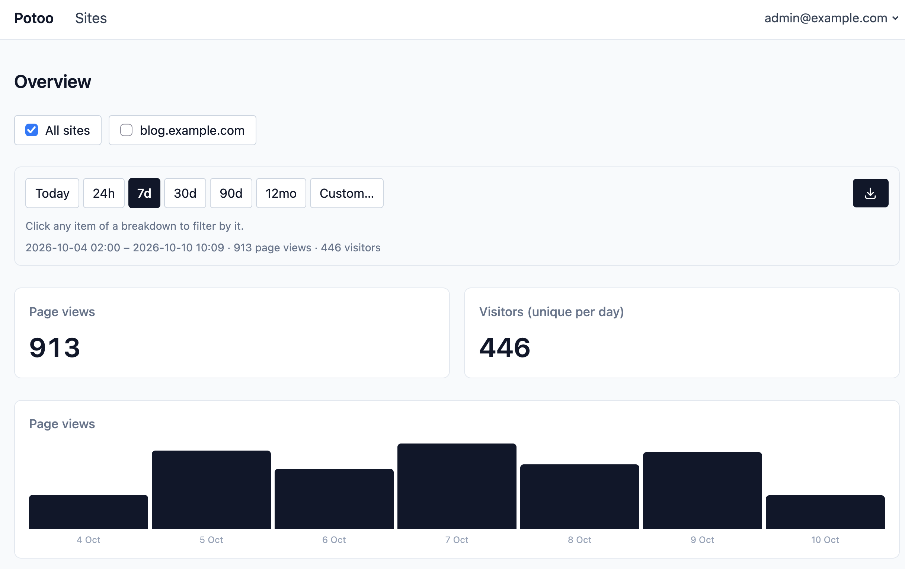
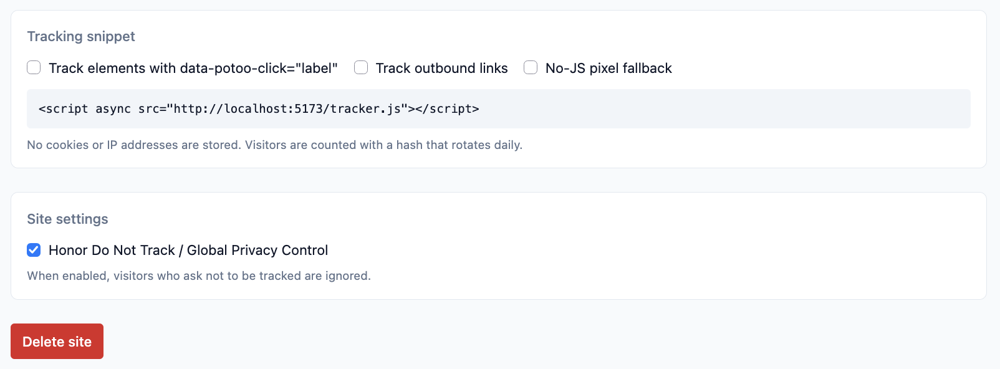
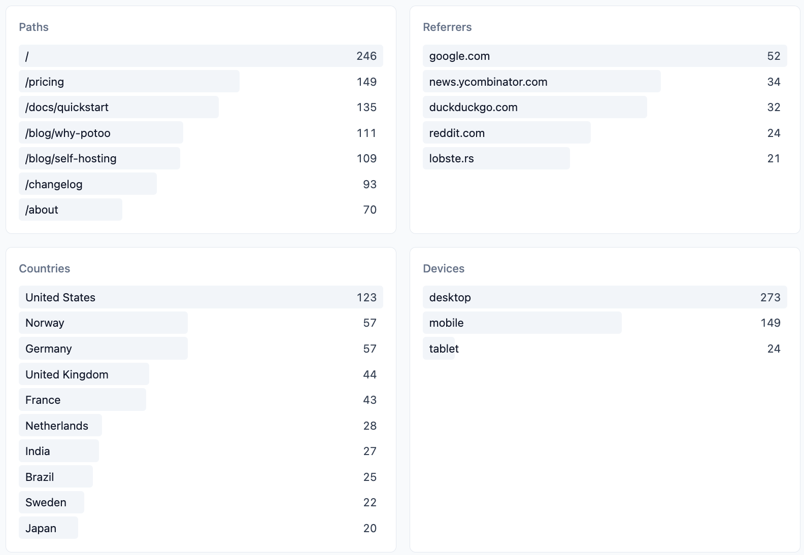
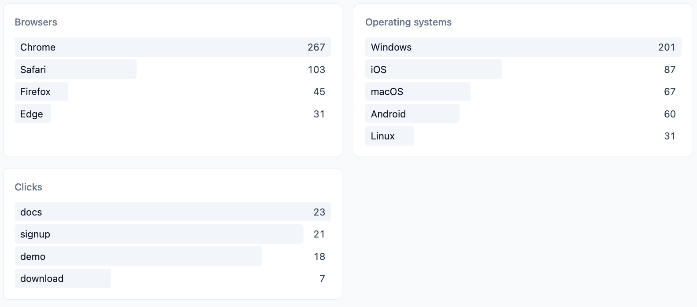

# Potoo

A small, privacy-friendly web analytics tool you host yourself. One binary
serves the dashboard and collects the numbers; your visitors keep their
identity, and you keep your data.



## Why Potoo

- **No cookies, no consent banner.** There is nothing to consent to: no cookies,
  no localStorage, no fingerprinting.
- **No personal data stored.** IP addresses and user agents are used in memory
  to derive the country, the device class, the browser family and the operating
  system, and are then discarded.
- **Visitors cannot be tracked across days or sites.** Unique visitors are
  counted with a hash of a daily salt, so yesterday's visitor and today's
  visitor are two different numbers, and the same person on two of your sites is
  two visitors.
- **Your data is yours.** One SQLite file, a full CSV export of every recorded
  hit, and optional retention that deletes old data for you.

## What you get

- **Dashboards per site and across sites**, with a multi-select to combine any
  subset of your sites into one view.
- **A complete chart**: hours for today and the last 24 hours, days up to a
  month, weeks up to 90 days, and months for a year — always aligned to the
  calendar, always showing every bucket, empty or not.
- **Breakdowns**: top paths, referrers, countries, devices, browsers, operating
  systems, and clicks on elements you label.
- **A snippet generator** on every site's page: a single script tag, with
  optional click tracking, outbound link tracking, and a no-JS pixel fallback.
  SPA navigation via `pushState` is tracked.
- **CSV export** of all hits, filtered like the dashboard view.
- **Multiple users, any number of admins**, with role management, password
  resets, and per-user settings (email, password, date format).







## Self-hosting

### Docker

The CI publishes an amd64 image to the GitHub Container Registry, so
running your own instance is one command:

```bash
docker run -d --name potoo -p 8000:8000 -v potoo-data:/data ghcr.io/lmxrd/potoo
```

Or, as a `docker-compose.yml` — the database and the GeoIP database stay in
the `./data` folder next to it, and the image's built-in healthcheck is all
the supervision it needs:

```yaml
services:
  potoo:
    image: ghcr.io/lmxrd/potoo
    restart: unless-stopped
    ports:
      - "8000:8000"
    volumes:
      - ./data:/data
    environment:
      # Behind a reverse proxy that sets X-Forwarded-For and terminates
      # TLS; see the configuration table below for everything else.
      TRUST_PROXY: "1"
      # RETENTION_DAYS: "365"   # delete hits older than a year
```

```bash
docker compose up -d
```

To build the image yourself:

```bash
docker build -t potoo .
docker run -d --name potoo -p 8000:8000 -v potoo-data:/data potoo
```

The image is Alpine holding a single static binary: the frontend and
the database schema are embedded in it. The database and the GeoIP database
live in the `/data` volume. Build it yourself with `mise run build:docker`
(podman; the image is amd64, emulated on arm64 machines).

Behind a reverse proxy, set `TRUST_PROXY=1` so the client IP is read from
`X-Forwarded-For`, and terminate TLS there.

### A single binary

With [mise](https://mise.jdx.dev) (or Rust and [pnpm](https://pnpm.io) directly)
installed:

```bash
mise run build
./backend/target/release/potoo
```

The task builds the frontend and compiles everything into one binary: the
frontend is embedded in it. To run from source instead: `mise run start`.

### First run

Open `http://localhost:8000`; with no users yet, every page redirects to
`/setup`, where you create the first admin. Then:

1. Add a site on the **Sites** page (each subdomain is its own site).
2. Open the site's page and copy the tracking snippet into your pages.
3. Watch the dashboard.

## How tracking works

When someone visits a page with your snippet in it, their browser tells potoo
about the visit. Two public endpoints do that job — one for visitors whose
browser runs JavaScript, one for everyone else:

### `/tracker.js` — the script most visitors run

The snippet generator on every site's page produces a single script tag:

```html
<script async src="https://your-potoo.example/tracker.js"></script>
```

The script waits until the page has loaded, then sends one small message to
potoo (a POST to `/api/collect`) containing only the site's hostname, the
page's path, and — for the first pageview — the site the visitor came from. It
does the same again when a single-page app navigates within the site, so those
views are counted too. Options, combined as needed:

| Option             | What it does                                               |
| ------------------ | ---------------------------------------------------------- |
| `data-clicks`      | Records clicks on elements with `data-potoo-click="label"` |
| `data-outbound`    | Records clicks on links leaving your site                  |
| `data-host`        | Reports a different hostname than `location.host`          |
| The pixel fallback | Adds the `<noscript>` image tag below                      |

### `/api/collect` — where the hits arrive

The write endpoint of both the script and the pixel. On every hit, potoo
derives what the dashboard needs and then **discards the rest**:

- the IP address becomes a country (via the local GeoIP database) and is
  thrown away;
- the browser's user agent becomes the device class, browser family and
  operating system, and is thrown away;
- the page's query string and fragment are dropped (they often hold personal
  data), and only the referring hostname is kept, never the full URL;
- "unique visitor" is a salted, per-day, per-site hash of the IP and user
  agent — so the same person counts once a day per site, but cannot be
  followed across days, across sites, or linked back to an identity.

### `/api/pixel` — visitors without JavaScript

Some visitors have JavaScript off (or blocked). Browsers like that still
download images, so the snippet's optional fallback is an invisible 1x1 image:

```html
<noscript></noscript>
```

Requesting the image is the visit: potoo records a pageview using what the
request carries anyway (the query string's site and path, or the `Referer`
header), then returns the transparent GIF. It counts pageviews only — no
in-app navigation, no clicks.

Visitors who ask not to be tracked (Do Not Track or Global Privacy Control) are
ignored by default; each site can turn that off.

## Ranges, filters and the export

Every endpoint that filters by time — the stats of the overview, the stats of
one site, and the export — takes the same query params:

| Param   | What it is                                                                                     |
| ------- | ---------------------------------------------------------------------------------------------- |
| `range` | A rolling window ending now, as an ISO 8601 duration: `PT24H`, `P7D`, `P30D`, `P90D`, `P1Y`   |
| `from`+`to` | Instead of a duration: an exact window, ISO timestamps in UTC with minute precision         |
| `sites` | Comma-separated site ids; when absent, every site                                              |
| `q`     | A filter over the dashboard's facets, e.g. `country==NO;path==/pricing`                        |

The dashboard's "Today" view is a `from`/`to` pair: UTC midnight to now. The
`q` filter is equality on the facets the dashboard shows, OR (`,`) within one
facet and AND (`;`) across them.

The export is `GET /api/export` with those params, and returns raw data only:
one CSV row per recorded hit — site, timestamp, kind, path, name, referrer,
country, device, browser, operating system — oldest first. It is the same set
of rows the dashboard view is computed from, so what you see is what you get.

## Configuration

| Variable         | Default             | Purpose                                                                                                                      |
| ---------------- | ------------------- | ---------------------------------------------------------------------------------------------------------------------------- |
| `PORT`           | `8000`              | HTTP port                                                                                                                    |
| `DATABASE_PATH`  | `data/potoo.db`     | SQLite file                                                                                                                  |
| `GEOIP_DB_PATH`  | `data/country.mmdb` | MaxMind-format country DB. Downloaded from DB-IP on boot when missing or older than a week, and refreshed weekly             |
| `GEOIP_URL`      | unset               | Override the download URL, e.g. your own mirror. Empty string disables downloading; a missing file then leaves country empty |
| `TRUST_PROXY`    | unset               | Set to `1` to read the client IP from `X-Forwarded-For` (behind a reverse proxy)                                             |
| `RETENTION_DAYS` | unset               | Delete hits older than this                                                                                                  |

This site or product includes IP data from db-ip.com, licensed under CC BY 4.0.

## Notes

- The tracker accepts hits for registered sites but does not verify `Origin`, so
  a determined visitor can send spoofed hits. Acceptable for analytics, worth
  knowing.

## Contributing

Development setup, the task list, the code layout and the conventions a
change must follow live in [CONTRIBUTING.md](CONTRIBUTING.md).
