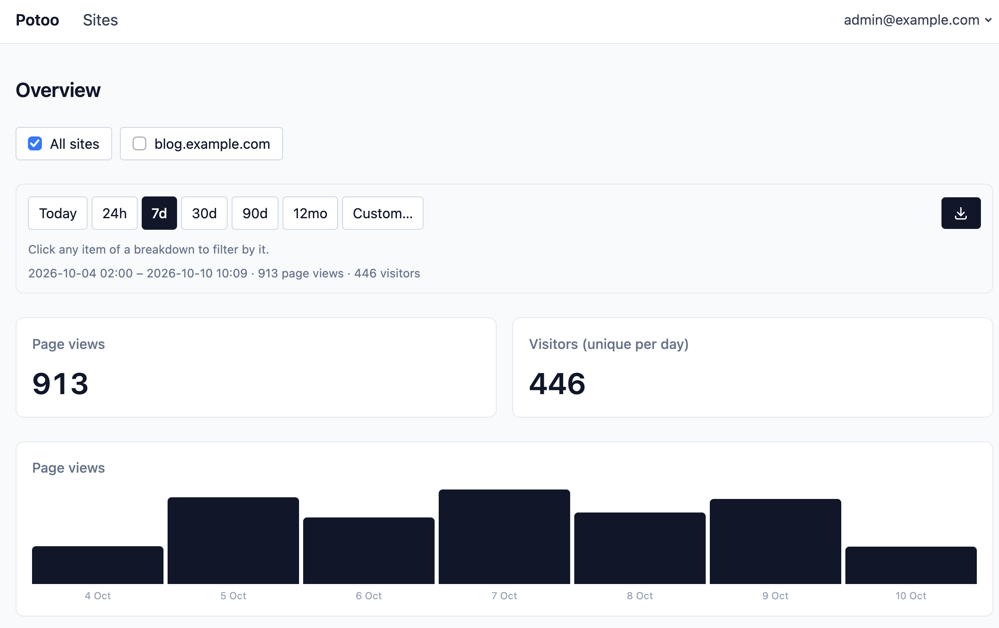
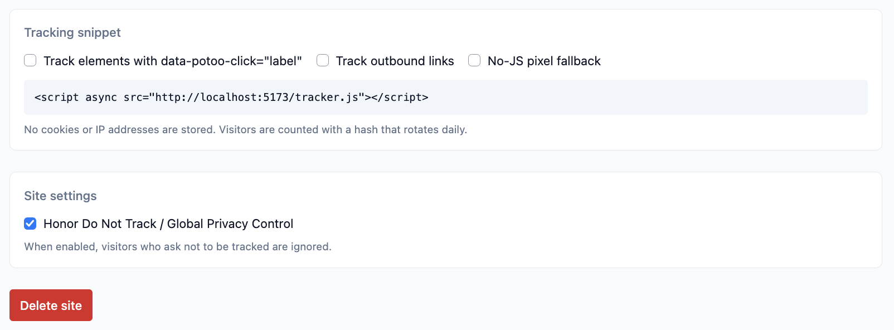
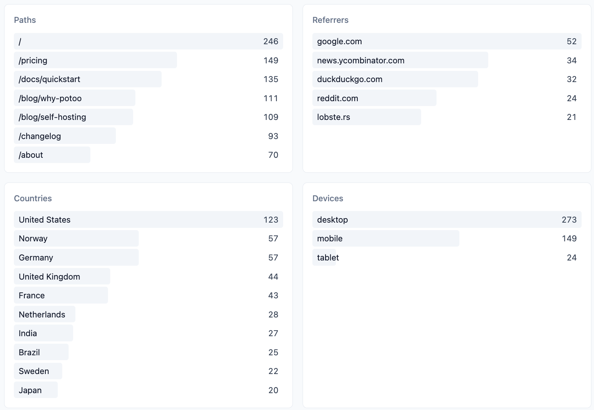
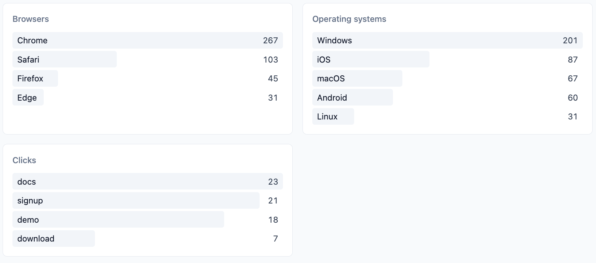

# Potoo

> A [potoo](https://en.wikipedia.org/wiki/Potoo) is a funny looking bird with huge eyes, that stares at your analytics data

A small, privacy-friendly web analytics tool you host yourself. One binary
serves the dashboard and collects the numbers; your visitors keep their
identity, and you keep your data.



## Why Potoo

- **No cookies, no consent banner.** There is nothing to consent to: no cookies,
  no localStorage, no fingerprinting.
- **No personal data stored.** IP addresses and user agents are used in memory
  to derive the country, the device class, the browser family and the operating
  system, and are then discarded.
- **Visitors cannot be tracked across days or sites.** Unique visitors are
  counted with a hash of a daily salt, so yesterday's visitor and today's
  visitor are two different numbers, and the same person on two of your sites is
  two visitors.
- **Your data is yours.** One SQLite file, a full CSV export of every recorded
  hit, and optional retention that deletes old data for you.

## What you get

- **Dashboards per site and across sites**, with a multi-select to combine any
  subset of your sites into one view.
- **A complete chart**: hours for today and the last 24 hours, days up to a
  month, weeks up to 90 days, and months for a year — always aligned to the
  calendar, always showing every bucket, empty or not.
- **Breakdowns**: top paths, referrers, countries, devices, browsers, operating
  systems, and clicks on elements you label.
- **A snippet generator** on every site's page: a single script tag, with
  optional click tracking, outbound link tracking, and a no-JS pixel fallback.
  SPA navigation via `pushState` is tracked.
- **CSV export** of all hits, filtered like the dashboard view, and an admin-only **CSV import** of the same format.
- **Multiple users, any number of admins**, with role management, password
  resets, and per-user settings (email, password, date and time format, theme).
- **Single sign-on** with any OpenID Connect provider (Authentik, Keycloak,
  Authelia, Google, ...), next to passwords; set up in the admin settings or
  with environment variables.
- **API keys** per user, read, read & write or admin, for scripts.
- **Two-factor authentication** with any authenticator app (TOTP) and
  single-use recovery codes, optionally required for everyone.







## Self-hosting

### Docker

Every release publishes a multi-arch image (amd64 and arm64) to the GitHub
Container Registry, so running your own instance is one command:

```bash
docker run -d --name potoo -p 8000:8000 -v potoo-data:/data ghcr.io/lmxrd/potoo
```

Or, as a `docker-compose.yml` — the database and the GeoIP database stay in
the `./data` folder next to it, and the image's built-in healthcheck is all
the supervision it needs:

```yaml
services:
  potoo:
    image: ghcr.io/lmxrd/potoo
    restart: unless-stopped
    ports:
      - "8000:8000"
    volumes:
      - ./data:/data
    environment:
      # Where Potoo is reached: an https address makes its cookies Secure.
      PUBLIC_URL: "https://stats.example.com"
      # Behind a reverse proxy that sets X-Forwarded-For and terminates TLS;
      # see the configuration table below for everything else.
      TRUST_PROXY: "true"
      # RETENTION_DAYS: "365"   # delete hits older than a year
```

```bash
docker compose up -d
```

To build the image yourself:

```bash
mise run build:docker
docker run -d --name potoo -p 8000:8000 -v potoo-data:/data potoo
```

The image is Alpine holding a single static binary: the frontend and
the database schema are embedded in it. The database and the GeoIP database
live in the `/data` volume. `mise run build:docker` builds the binary first,
outside the image and with your own cargo cache (`mise run build:linux`,
into `dist/potoo-linux-<arch>`), then the image (podman) for the
architecture of your machine. The binary is cross-compiled with zig, so a
Mac builds it too; `ARCH=amd64` or `arm64` builds the other architecture.

Set `PUBLIC_URL` to the address Potoo is reached at. When it is https,
every cookie is `Secure` with the `__Host-` prefix, so it is only ever sent
over https and no other subdomain can set or read it; requests that change
something must come from that address (browsers say where a request comes
from in `Sec-Fetch-Site`, older ones in `Origin`); and single sign-on's
callback is under it. Behind a reverse proxy, also set `TRUST_PROXY=true`,
so the client's address (for the visitor counts and the sign-in limits) is
read from `X-Forwarded-For`, and terminate TLS there.

### Staying up to date

Dependencies and the image's base are updated automatically, and a security
fix leads to a patch release (`1.2.3` → `1.2.4`). To pick those up without
taking new features unannounced, run the minor tag (`ghcr.io/lmxrd/potoo:1.2`)
and pull it regularly, or let a tool such as
[Watchtower](https://containrrr.dev/watchtower/) or
[Diun](https://crazymax.dev/diun/) do it or tell you. `latest` follows every
release.

### A single binary

With [mise](https://mise.jdx.dev) (or Rust and [pnpm](https://pnpm.io) directly)
installed:

```bash
mise run build
./dist/potoo
```

The task builds the frontend and compiles everything into one binary: the
frontend is embedded in it. To run from source instead: `mise run start`.

### First run

Open `http://localhost:8000`; with no users yet, every page redirects to
`/setup`, where you create the first admin. Then:

1. Add a site on the **Sites** page (each subdomain is its own site).
2. Open the site's page and copy the tracking snippet into your pages.
3. Watch the dashboard.

## How tracking works

When someone visits a page with your snippet in it, their browser tells potoo
about the visit. Two public endpoints do that job — one for visitors whose
browser runs JavaScript, one for everyone else:

### `/tracker.js` — the script most visitors run

The snippet generator on every site's page produces a single script tag:

```html
<script async src="https://your-potoo.example/tracker.js"></script>
```

The script waits until the page has loaded, then sends one small message to
potoo (a POST to `/api/collect`) containing only the site's hostname, the
page's path, and — for the first pageview — the site the visitor came from. It
does the same again when a single-page app navigates within the site, so those
views are counted too. Options, combined as needed:

| Option             | What it does                                               |
| ------------------ | ---------------------------------------------------------- |
| `data-clicks`      | Records clicks on elements with `data-potoo-click="label"` |
| `data-outbound`    | Records clicks on links leaving your site                  |
| `data-host`        | Reports a different hostname than `location.host`          |
| The pixel fallback | Adds the `<noscript>` image tag below                      |

### `/api/collect` — where the hits arrive

The write endpoint of both the script and the pixel. On every hit, potoo
derives what the dashboard needs and then **discards the rest**:

- the IP address becomes a country (via the local GeoIP database) and is
  thrown away;
- the browser's user agent becomes the device class, browser family and
  operating system, and is thrown away. Those are stored as lowercase keys
  (`no`, `desktop`, `chrome`, `macos`); the dashboard decides what to call
  them. A client or platform Potoo does not know is kept under the short
  name it announces (`palemoon`, `cros`), never as the user agent, and is
  reported once in the server's log so it can be given a name;
- the page's query string and fragment are dropped (they often hold personal
  data), and only the referring hostname is kept, never the full URL;
- "unique visitor" is a salted, per-day, per-site hash of the IP and user
  agent — so the same person counts once a day per site, but cannot be
  followed across days, across sites, or linked back to an identity.

### `/api/pixel` — visitors without JavaScript

Some visitors have JavaScript off (or blocked). Browsers like that still
download images, so the snippet's optional fallback is an invisible 1x1 image:

```html
<noscript></noscript>
```

Requesting the image is the visit: potoo records a pageview using what the
request carries anyway (the query string's site and path, or the `Referer`
header), then returns the transparent GIF. It counts pageviews only — no
in-app navigation, no clicks.

Visitors who ask not to be tracked (Do Not Track or Global Privacy Control) are
ignored by default; each site can turn that off.

## Ranges, filters and the export

Every endpoint that filters by time — the stats of the overview, the stats of
one site, and the export — takes the same query params:

| Param   | What it is                                                                                     |
| ------- | ---------------------------------------------------------------------------------------------- |
| `from`+`to` | Both required: the exact window, as ISO 8601 timestamps (the `to` instant included). It spans at most 730 days — two years |
| `sites` | Comma-separated hostnames, e.g. `blog.example.com,shop.example.com`; when absent, every site. An unknown hostname is a 400 |
| `q`     | A filter over the dashboard's facets, e.g. `country==NO;path==/pricing`                        |

The dashboard's presets (`24h`, `7d`, `30d`, ...) are a URL shorthand: the
dashboard turns each into its exact `from`/`to` window when the request is
made, so a preset stays rolling as long as the dashboard keeps re-fetching
it. The `q` filter is equality on the facets the dashboard shows, OR (`,`)
within one facet and AND (`;`) across them.

The export is `GET /api/export` with those params, and returns raw data only:
one CSV row per recorded hit — site, timestamp, kind, path, name, referrer,
country, device, browser, operating system — oldest first. It is the same set
of rows the dashboard view is computed from, so what you see is what you get.

The import (admins only; "Import hits" in the account menu) is
`POST /api/import` with a file in the export's format, as a multipart `file`
part or as a `text/csv` body, up to 256 MB. It is all or nothing: if a row
cannot be read, or names a site that does not exist, nothing is added and
the answer says what is wrong and on which line. The export ends with a
`visitor` column (the pseudonymous hash of the day) and the import takes it
back, so a round trip keeps the unique visitors; the column is optional in a
file to import. A hit without one adds a page view but no unique visitor.
Sites that do not exist are refused, or created when the request has
`create_sites=true` (the import page has a toggle for it). Country, device, browser and OS may be empty (they show as Unknown), and rows
are not checked for duplicates.

## Configuration

| Variable             | Default             | Purpose                                                                                                                                     |
| -------------------- | ------------------- | ------------------------------------------------------------------------------------------------------------------------------------------- |
| `PORT`               | `8000`              | HTTP port                                                                                                                                   |
| `DATABASE_URL`       | `sqlite:data/potoo.db` | The database, as a URL. SQLite only for now: `sqlite:` and the file's path, e.g. `sqlite:/data/potoo.db`                               |
| `SQLITE_SYNCHRONOUS` | `NORMAL`            | How hard SQLite syncs to disk: `NORMAL` is fast and safe (a power cut can lose the last few hits, never corrupt); `FULL` syncs every commit |
| `GEOIP_DB_PATH`      | `data/country.mmdb` | MaxMind-format country DB. Downloaded from DB-IP on boot when missing or older than a week, and refreshed weekly (the current month's file, or last month's until the new one is published)                            |
| `GEOIP_URL`          | unset               | Override the download URL, e.g. your own mirror. Empty string disables downloading; a missing file then leaves country empty                |
| `PUBLIC_URL`         | unset               | The address Potoo is reached at, e.g. `https://stats.example.com`. https makes every cookie `Secure` and `__Host-`; it is also the only origin changes are taken from, and single sign-on's callback is under it. Unset (local use): plain cookies, the request's own host |
| `TRUST_PROXY`        | `false`             | `true` to read the client IP from `X-Forwarded-For` (behind a reverse proxy)                                                               |
| `RUST_LOG`           | `info`              | What is logged, e.g. `debug` or `potoo=debug,tower_http=info`                                                                              |
| `RETENTION_DAYS`     | unset               | Delete hits older than this                                                                                                                 |
| `OIDC_ISSUER`        | unset               | Single sign-on: the provider's issuer URL (`https://`). With `OIDC_CLIENT_ID`, turns single sign-on on; see [Single sign-on](#single-sign-on) |
| `OIDC_CLIENT_ID`     | unset               | Single sign-on: the client id registered with the provider                                                                                  |
| `OIDC_CLIENT_SECRET` | unset               | Single sign-on: the client secret, if the provider gave one                                                                                 |
| `OIDC_SCOPES`        | `openid email`      | Single sign-on: the scopes asked for, space separated                                                                                       |
| `OIDC_LABEL`         | `Single sign-on`    | Single sign-on: the login button says "Sign in with" this                                                                                   |
| `OIDC_REDIRECT_URL`  | unset               | Single sign-on: the callback URL, when the one Potoo works out from the request is not right (`https://…/api/auth/oidc/callback`)           |
| `OIDC_AUTO_CREATE`   | `false`             | Single sign-on: `true` creates a regular user for a verified email that has no account; `false` does not |
| `OIDC_ONLY`          | `false`             | Single sign-on: `true` makes single sign-on the only way in: no password signs in and none can be set. The first admin is still created with a password on `/setup`, then signs in through the provider (matched by their verified email) |
| `TOTP_REQUIRED`      | `false`             | `true` makes two-factor authentication required: a user without it sets up an authenticator app at their next sign-in (password or single sign-on), and nobody can turn it off. Sessions made before are kept |

`TRUST_PROXY`, `OIDC_AUTO_CREATE`, `OIDC_ONLY` and `TOTP_REQUIRED` take `true` or `false`
(`1`/`0`, `yes`/`no` and `on`/`off` work too); any other value stops Potoo at
start.

A session lasts 30 days from the sign-in. Changing the password or the
two-factor setup signs the user's other sessions out, and deleting a user
signs them out everywhere at once.

This site or product includes IP data from db-ip.com, licensed under CC BY 4.0.

### Single sign-on

Users can sign in with an OpenID Connect provider as well as with a password.
Set it up under **Admin settings** (the account menu, admins only) or with the
`OIDC_*` variables above. A variable that is set wins over its field, which the
admin settings then show as locked; changes made there apply at once.

1. Register Potoo with the provider as a confidential (or public) client using
   the authorization code flow, with the callback URL the admin settings show:
   `https://<your potoo>/api/auth/oidc/callback`.
2. Enter the issuer URL, the client id and the secret. Saving checks that the
   provider answers, over https (its own endpoints too). A new issuer drops
   the old provider's secret unless you enter one with it; while the secret
   comes from `OIDC_CLIENT_SECRET`, set the issuer with `OIDC_ISSUER` too.

Who may sign in:

- a user already linked to the provider account (the provider's `sub`);
- else the user whose email is the one the provider gives, when the provider
  says it is verified (`email_verified`); they are linked from then on, so a
  later email change at the provider does not matter. A user already linked
  to another account at that provider is not (a recycled address, say);
- else, with auto-create on, a new regular (not admin) user without a password.

The first admin is still created with a password on `/setup`; until then,
single sign-on signs nobody in. A user without a password can set one in
their settings; an admin can create a user without a password while single
sign-on is on.

With `OIDC_ONLY=true`, single sign-on is the only way in: the login page shows no
password form, a password sign-in is refused (403), and no password can be set
or reset, so new users are created without one. Two-factor authentication is
then the provider's business. Sessions and API keys keep working. Until single
sign-on is set up (with the variables, or in the admin settings by the first
admin, signed in after `/setup`), nobody else can sign in; Potoo logs a
warning at start.

The callback URL is `PUBLIC_URL` followed by `/api/auth/oidc/callback`, or
`OIDC_REDIRECT_URL` when set. It must be on the scheme (http or https) of
`PUBLIC_URL`: a login where it is not is refused at once (the log says
why). A sign-in in progress lives in a cookie for ten minutes,
signed with a key made when Potoo starts: a restart, or a second sign-in
started in another tab, makes it fail, and trying again works.

Some providers (Microsoft Entra, for one) do not say that an email is
verified. Potoo then can neither match nor create the user, so their users
cannot sign in through it yet.

### Two-factor authentication

Each user can turn it on in **Settings**: scan the QR code with an
authenticator app (or type the key), confirm with a code, and keep the ten
recovery codes it shows once. From then on, signing in (with a password or
with single sign-on) also asks for a code from the app, or a recovery code
(each works once). A code is
accepted for 30 seconds either side of its own, and only once.

Every attempt to sign in or enter a code counts, right or wrong: 5 per
email address, then 1 a minute; 30 per client address, then 1 every 6
seconds; and 5 codes (or current passwords) per user, then 1 a minute.
Over that, Potoo answers 429 with `Retry-After`. Nobody is ever locked out,
so nobody can lock someone else out, only slow down guessing.

Turning it off, making new recovery codes, or moving to a new phone or app
(**Replace app**) needs a code. A replacement shows a new QR code, and the old
app keeps working until a code from the new one confirms it; the recovery
codes stay the same. An admin can turn
it off for a user who lost both their app and their recovery codes (**Reset
2FA** in the admin settings), not for themselves. The second step must
follow the first within five minutes, in the same browser; a restart of Potoo
makes it start over.

With `TOTP_REQUIRED=true`, a user who has not set it up does so at their next
sign-in, before they get in, and it cannot be turned off; after an admin's
reset, they set it up again at their next sign-in.

### API keys

Each user can create API keys under **Settings** for scripts, and send one as
`Authorization: Bearer potoo_…` wherever the dashboard's session works. The
key is shown once, when it is made. A key's permission caps what it may do,
and never goes beyond its user's role:

- **Read**: GET requests only (stats, sites, exports).
- **Read & write**: changes too, but no admin endpoints.
- **Admin** (admins only): everything the admin may do.

No key reaches its user's own account: email, password, two-factor
authentication and API keys need a signed-in session. A key may expire
(30 days, 90 days, a year, or never); revoking it, or deleting its user,
stops it at once. Each key shows when it was last used (to the minute).

### How hits are stored

A hit is answered as soon as it is queued, and a single writer commits the
queued hits to the database in batches, typically within a few
milliseconds. A clean stop (`docker stop`, a deploy) finishes the requests
in flight and writes everything queued. A crash or a power cut can lose the
hits still queued — the last few milliseconds — and, with the default
`SQLITE_SYNCHRONOUS=NORMAL`, the last few commits. Past a queue of 20,000
waiting hits the tracker answers `503` instead of buffering more.

## Upgrading from 0.6

Potoo is before 1.0, so a release can change how it is set up. The next one
does:

- **Everyone signs in again once.** Sessions moved to a new store; the old
  ones are dropped.
- **Behind an https proxy, set `PUBLIC_URL`** (e.g. `https://stats.example.com`).
  It replaces what Potoo worked out from `X-Forwarded-Proto` and
  `X-Forwarded-Host`, which it no longer reads: without it, cookies are not
  `Secure`, single sign-on's callback is plain http, and older browsers'
  changes are refused.
- **Sign-in limits changed.** Instead of locking an address and email out
  after 5 failures in 15 minutes, every attempt counts and the limit is a
  pace (see [Two-factor authentication](#two-factor-authentication)).
- **No glibc builds.** Releases attach only the static (musl) binaries, which
  run on any Linux, with their SHA-256 checksums.
- **Ids are UUIDs.** Users, sites and API keys have UUIDv7 ids (strings in
  the API, such as `0190f5b2-7c00-7c1a-9d3e-5b7a1c2d3e4f`) instead of
  numbers. The upgrade converts them, keeping every relation; it rewrites
  the hits table, so on a large database it takes a while. Today's unique
  visitors may be counted twice across the upgrade.
- **`DATABASE_PATH` is now `DATABASE_URL`**, a database URL:
  `DATABASE_PATH=/data/potoo.db` becomes `DATABASE_URL=sqlite:/data/potoo.db`
  (the image sets it already).
- **`RUST_LOG`** now picks what is logged (default `info`).

## The API

Every endpoint is described in an OpenAPI 3.1 document, generated from the code
rather than hosted: `mise run gen:spec` writes it to
`packages/backend/target/specs/openapi.json`. The dashboard's API client is generated from
it, and you can load it into any OpenAPI viewer or client generator.

## Notes

- The tracker accepts hits for registered sites but does not verify `Origin`, so
  a determined visitor can send spoofed hits. Acceptable for analytics, worth
  knowing.

## Contributing

Development setup, the task list, the code layout and the conventions a
change must follow live in [CONTRIBUTING.md](CONTRIBUTING.md).
